<p align="center">
  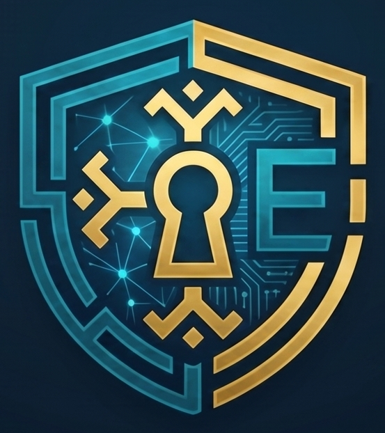
</p>

<h1 align="center">Ellkan</h1>
<p align="center">Zero-knowledge, self-hosted password manager.</p>
<p align="center"><a href="README.md">Español</a> · <b>English</b> (this file)</p>

<p align="center">
  <a href="https://www.buymeacoffee.com/athomo"></a>
</p>

**Ellkan** — from Mapudungun *elkan*, "to hide, to conceal."

> [!WARNING]
> **Beta software.** The UI, data schema and API may change between versions without an automatic migration path. Don't rely on it yet as your organization's only password manager.

## What Ellkan is

A self-hosted password manager with a zero-knowledge architecture: the server never sees your private keys or your secrets in plaintext. Backend in Rust (Axum), encryption with modern primitives (X25519, Ed25519, XChaCha20-Poly1305, Argon2id), web frontend and browser extension share the same cryptographic core compiled to WebAssembly.

## Apps

| App | What it is for | More information |
| --- | --- | --- |
| **Web + server** | The Ellkan server for a team: users, groups, sharing and administration. It is what the [server installation](#installing-the-server-docker) sets up. | [Installation manual](manual/instalacion.md) |
| **Desktop (Windows)** | A password manager for **one person**. Everything stays encrypted on your PC: it works offline, with no server and no cloud account, and can optionally connect to an Ellkan server. It ships with an MSI installer, a tray icon with a global shortcut, a «Connect» button (SSH, RDP, PostgreSQL, MySQL, MongoDB, FTP, Telnet, VNC), vault health checks, automatic backups and the browser extension built in. | [Desktop app guide](app-escritorio/GUIA.md) (Spanish) |
| **Browser extension** | Autofills your credentials in Chrome, Edge, Brave, Opera and Firefox. It works with the server or with the desktop app, which can also install it. | [Browser extension](extension/README.md) (Spanish) |

## Downloads

Ellkan ships as **two independent parts**. Pick by who it is for:

| | **Personal use** | **Team or company** |
| --- | --- | --- |
| What it is | Desktop app + browser extension | Ellkan server with its web app |
| Where to get it | [Releases](https://github.com/athomo001/Ellkan/releases/latest) | Docker image `ghcr.io/athomo001/ellkan` |
| Needs a server or Docker | No | Yes (Docker) |
| Users | One person, everything encrypted on your PC | Many: groups, sharing, SSO/LDAP/SCIM, audit log |
| Includes the desktop app | Yes | **No**: download it separately from Releases |

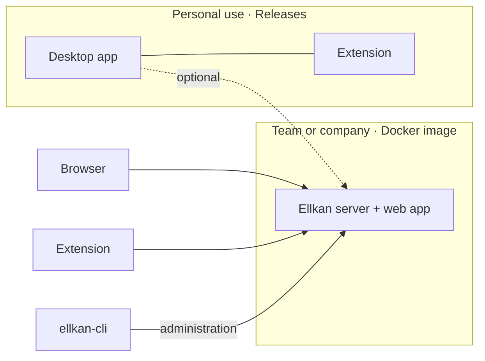

### Personal use: desktop app and extension (Releases)

Every version is published on **[Releases](https://github.com/athomo001/Ellkan/releases/latest)** (that link always points to the latest one). No Docker or server needed:

| File | What it is |
| --- | --- |
| `Ellkan_X.Y.Z_x64_es-ES.msi` | Desktop app for Windows (installer, includes the extension) |
| `Ellkan_X.Y.Z_x64_portable.zip` | The same app, no install needed |
| `Ellkan_X.Y.Z_amd64.AppImage` · `Ellkan_X.Y.Z_amd64.deb` | Desktop app for Linux (experimental: the [guide](app-escritorio/GUIA.md) still covers Windows only) |
| `ellkan-chrome-X.Y.Z.zip` (also `-edge`, `-brave`, `-opera`) | Extension for Chromium browsers |
| `ellkan-firefox-X.Y.Z.xpi` | Extension for Firefox |

How to load the extension by hand in each browser: [extension/README.md](extension/README.md) (Spanish).

### Team or company: the server (Docker)

The server is **not among the Release files**: it is published as a Docker image at `ghcr.io/athomo001/ellkan`, tagged `latest` (newest version), `X.Y` and `X.Y.Z`. The [server installation](#installing-the-server-docker) pulls it for you. It contains the server and the web app, but **not the desktop app**.

Once it is running, everyone signs in from the browser. The extension and, optionally, the desktop app connect to that server. To administer it (create the first admin, backups) there is the CLI, which is downloaded from Releases: `ellkan-cli_X.Y.Z_windows_x64.exe` · `ellkan-cli_X.Y.Z_linux_x64`.

### Versions and verification

Official versions come from `main` and are the ones marked "Latest". The `vX.Y.Z-dev.N` pre-releases (and the `:dev` image) come from the development branch, are replaced on every change and are not meant for production.

To verify a download: `sha256sum -c SHA256SUMS.txt --ignore-missing` on Linux, or `Get-FileHash <file>` in PowerShell and compare it with its line in `SHA256SUMS.txt`.

## Screenshots

| Vault | Admin panel | New item |
| --- | --- | --- |
| 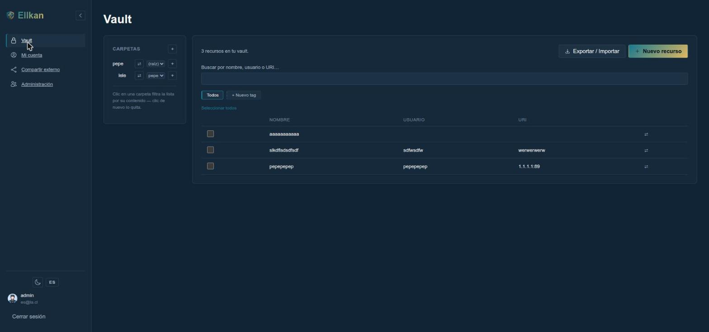 | 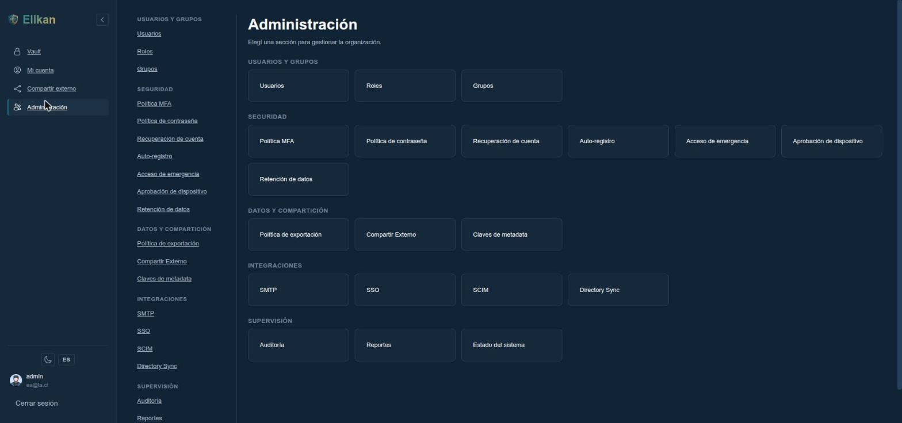 | 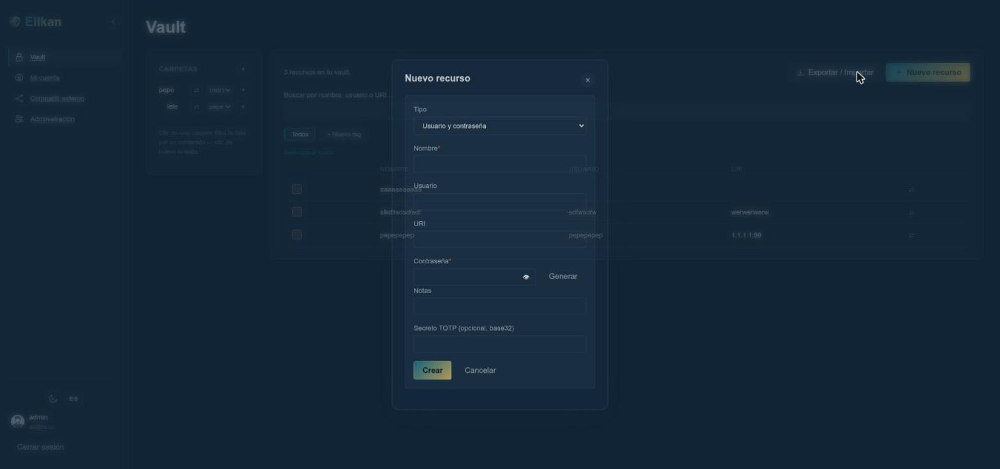 |

| Extension — item detail | Extension — password generator |
| --- | --- |
| 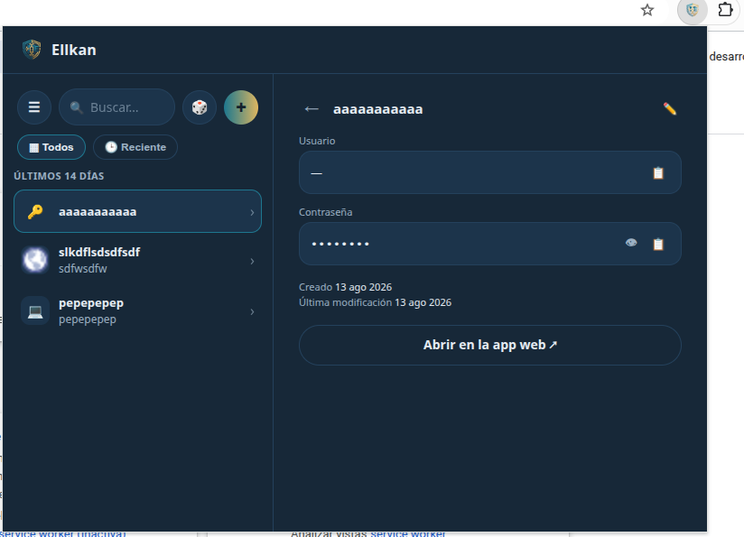 | 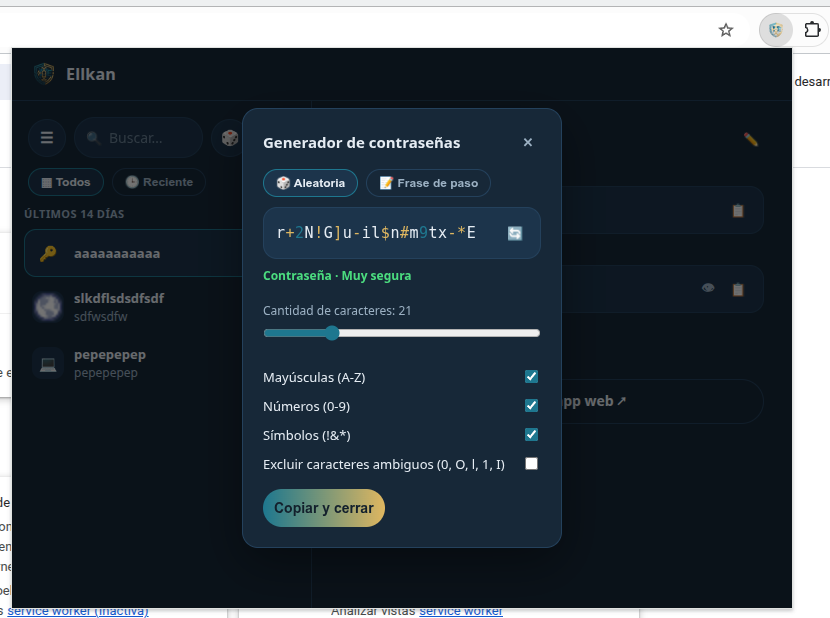 |

### Desktop app (Windows)

| MSI installer | First run: create the account |
| --- | --- |
| 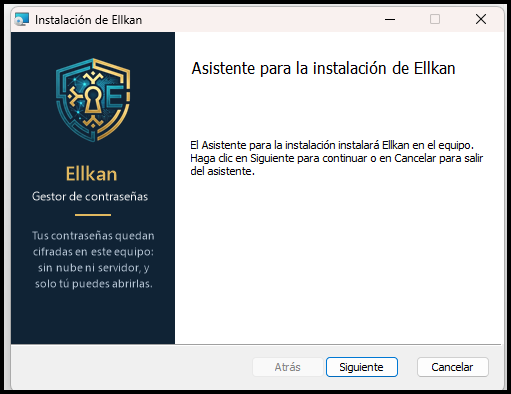 | 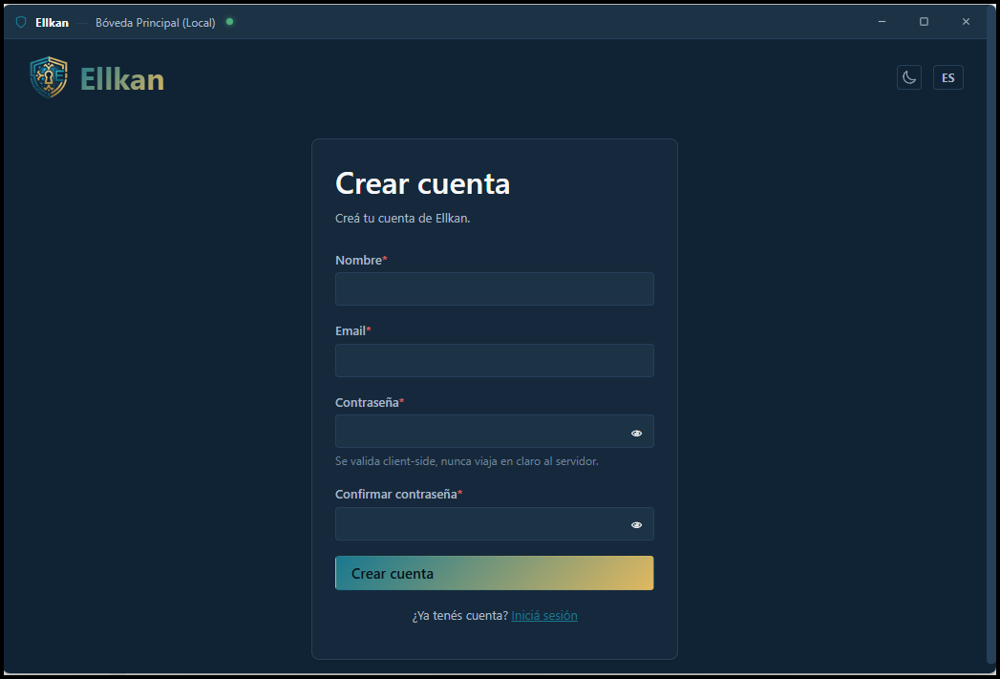 |

| New item: SSH, RDP, databases… | «Connect» opens the client ready to go |
| --- | --- |
| 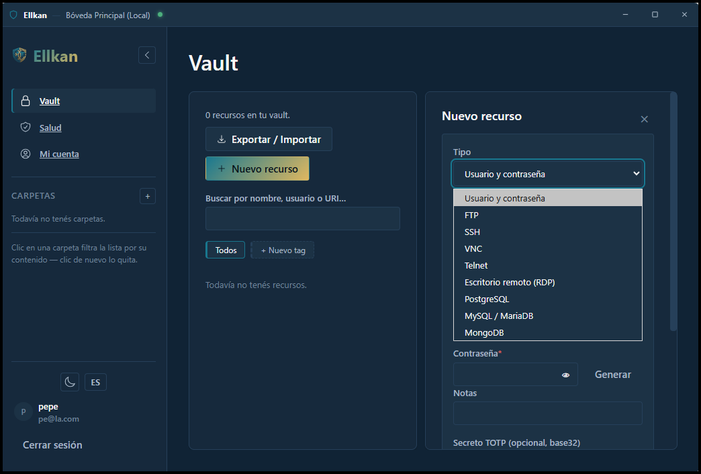 | 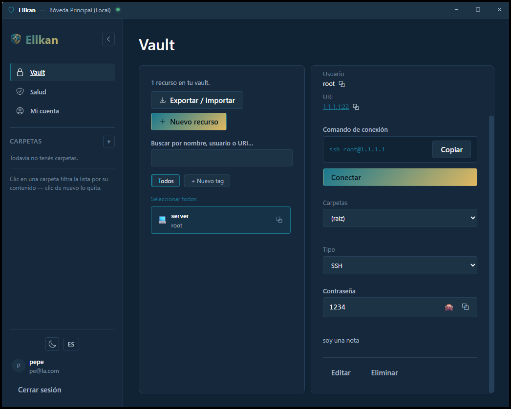 |

## Tech stack

### Backend

| Component | Technology |
| --- | --- |
| Language | Rust (2024 edition) |
| Web framework | Axum (on Tokio) |
| Database | PostgreSQL 18+ |
| Data access | `sqlx`, compile-time verified queries |
| Authentication | Ed25519 nonce-signature — no passwords stored server-side |
| Architecture | Modular monolith (Controller → Service → Repository) |
| Deployment | Docker / Docker Compose |

### Frontend and extension

| Component | Technology |
| --- | --- |
| Web frontend | SvelteKit + TypeScript |
| Browser extension | Manifest V3 (Chrome, Firefox, Safari) |
| Cryptographic core | Compiled to WebAssembly, shared across backend, web, and extension |
| Package manager | pnpm |
| E2E testing | Playwright |

### Cryptography

| Primitive | Use |
| --- | --- |
| X25519 | Key agreement (end-to-end encryption) |
| Ed25519 | Digital signatures (authentication) |
| XChaCha20-Poly1305 | Authenticated encryption (AEAD) of secrets and metadata |
| Argon2id | Master key derivation from the passphrase |
| HKDF-SHA256 | Domain-separated subkey derivation per context |
| zeroize / secrecy | Secure wiping and redaction of secrets in memory |
| subtle | Constant-time comparisons (timing-attack mitigation) |

## Installing the server (Docker)

Nothing needs to be compiled: the server is pulled ready-made from `ghcr.io` (see [Downloads](#downloads)). There are five steps; each one has the commands for **Linux/macOS** (`bash`) and for **Windows** (PowerShell).

### 1. Install the prerequisites

**Linux/macOS:** Docker and Docker Compose, plus `git` and `openssl`.

**Windows** (once; sign out and back in when done):

```powershell
winget install --id Git.Git -e
winget install --id Docker.DockerDesktop -e
```

Open Docker Desktop and wait until it says the engine is running.

### 2. Clone and load the `.env`

```bash
git clone https://github.com/athomo001/Ellkan.git
cd Ellkan
cp .env.example .env
set -a && source .env && set +a
```

```powershell
git clone https://github.com/athomo001/Ellkan.git
cd Ellkan
Copy-Item .env.example .env

# Same as `set -a && source .env`: only lasts in this window.
Get-Content .env | Where-Object { $_ -match '^\s*[^#\s][^=]*=' } | ForEach-Object {
    $k, $v = $_ -split '=', 2
    Set-Item "env:$($k.Trim())" $v.Trim()
}
```

The `.env` is only loaded in that terminal: if you open another one, repeat the last line (bash) or the `Get-Content` block (PowerShell).

### 3. Generate the secrets

**First time only.** If you already started the server, don't regenerate them: the database keeps the password in its volume and the secrets key protects data that is already encrypted. Each file is described in [secrets/README.md](secrets/README.md).

```bash
openssl rand -hex 24 > secrets/postgres_password.txt
openssl rand -base64 32 > secrets/ellkan_secrets_key.txt
echo "postgres://${POSTGRES_USER:-ellkan}:$(cat secrets/postgres_password.txt)@ellkan-db:5432/${POSTGRES_DB:-ellkan}" > secrets/database_url.txt
```

```powershell
function Aleatorio([int]$n) {
    $b = New-Object byte[] $n
    [Security.Cryptography.RandomNumberGenerator]::Create().GetBytes($b)
    return ,$b
}

# Same as `openssl rand -hex 24` and `openssl rand -base64 32`.
$pass = -join ((Aleatorio 24) | ForEach-Object { $_.ToString('x2') })
Set-Content secrets/postgres_password.txt $pass -NoNewline -Encoding ascii
Set-Content secrets/ellkan_secrets_key.txt ([Convert]::ToBase64String((Aleatorio 32))) -NoNewline -Encoding ascii
Set-Content secrets/database_url.txt "postgres://$($env:POSTGRES_USER):$pass@ellkan-db:5432/$($env:POSTGRES_DB)" -NoNewline -Encoding ascii
```

In PowerShell, `-NoNewline -Encoding ascii` matters: `>` or `echo` write UTF-16 or append `\r\n`, and that `\r` ends up stuck to the password inside the Linux container.

### 4. Start it

```bash
docker compose up -d
```

This pulls the image for the version set in `ELLKAN_VERSION` (`.env`; `latest` by default, the latest official release) and, if it can't find it, builds it from this source tree (takes several minutes). To always build from source: `docker compose up -d --build`.

The app is now at `http://localhost:8080` (or the port in `ELLKAN_PORT`).

> On Windows, if it fails with `bind source path does not exist: .../secrets/postgres_password.txt` even though the file exists, Docker Desktop can't see the drive: restart it (or `wsl --shutdown`) and start again. Details in [manual/instalacion.md](manual/instalacion.md#problemas-comunes-y-cómo-repararlos) (Spanish).

### 5. Create the first administrator (setup token)

The first account created on an empty instance becomes **admin**. So that nobody who reaches the web before you takes that role, that first account **asks for a setup token**:

1. **Get the token.** While there are no accounts, the server generates a random one on every start and writes it to its log:

   ```bash
   docker logs ellkan 2>&1 | grep "token de instalación"
   ```

   ```powershell
   docker logs ellkan 2>&1 | Select-String "token de instalación"
   ```

2. **Create the account.** Open `http://localhost:8080`, go to "Create account" and paste the token into the "Setup token" field. You can also open `http://localhost:8080/register#setup=<token>` directly.

3. Done: as soon as the first account exists, the token stops working and is never generated again. If you restart the container before creating it, it changes: check the log again.

To set your own token instead of the generated one (`ELLKAN_SETUP_TOKEN` or `ELLKAN_SETUP_TOKEN_FILE`, at least 24 characters), see the [manual](manual/instalacion.md#primer-administrador-token-de-instalación) (Spanish).

> [!IMPORTANT]
> **Versions up to and including 0.1.70 don't ask for the token:** the first sign-up becomes admin with nothing else. If the "Create account" screen has no setup token field, you are on one of those. Create your account before exposing the instance to the network, or use a newer version (`ELLKAN_VERSION=dev` in `.env` and `docker compose pull`, or build with `docker compose up -d --build`).

**Alternative: with the CLI.** It doesn't need the token because it talks to the database directly. Download `ellkan-cli_X.Y.Z_linux_x64` or `ellkan-cli_X.Y.Z_windows_x64.exe` from [Releases](https://github.com/athomo001/Ellkan/releases/latest) and save it in this folder as `ellkan-cli` / `ellkan-cli.exe` (or build it with `cargo build --release -p ellkan-cli`). The `DATABASE_URL` here points at `localhost`, not `ellkan-db` like the one in `secrets/`: the CLI runs outside the Docker network.

```bash
chmod +x ellkan-cli
DATABASE_URL="postgres://${POSTGRES_USER:-ellkan}:$(cat secrets/postgres_password.txt)@localhost:${POSTGRES_PORT:-5433}/${POSTGRES_DB:-ellkan}" \
  ./ellkan-cli admin create-user --email you@example.com --display-name "Your name" --role admin
./ellkan-cli --server-url "http://localhost:${ELLKAN_PORT:-8080}" login --email you@example.com
```

```powershell
$pass = (Get-Content secrets/postgres_password.txt -Raw).Trim()
$env:DATABASE_URL = "postgres://$($env:POSTGRES_USER):$pass@localhost:$($env:POSTGRES_PORT)/$($env:POSTGRES_DB)"
.\ellkan-cli.exe admin create-user --email you@example.com --display-name "Your name" --role admin
.\ellkan-cli.exe --server-url "http://localhost:$($env:ELLKAN_PORT)" login --email you@example.com
```

`--role admin` promotes directly over SQL (no HTTP route lets an account self-assign admin) and marks this device as known, so the `login` works without waiting on any email: no SMTP needed to get started. Once inside, configure a real relay at `/admin/smtp` so verification codes for other logins arrive by email. The rest of the commands: [manual/cli.md](manual/cli.md#comandos).

### After installing

By default the server serves plain HTTP. For TLS (terminated by Ellkan itself or by a reverse proxy), backup/restore and troubleshooting, see [manual/instalacion.md](manual/instalacion.md) (Spanish only, see disclaimer below).

### Updating / rebuilding after a change

**With the published image** (the usual case). If you pinned a version in `ELLKAN_VERSION` (`.env`), change it to the new one first; with `latest` there is nothing to change:

```bash
docker compose pull ellkan
docker compose up -d ellkan
```

Database migrations run on their own when the new version starts. Take a backup before updating ([manual/instalacion.md](manual/instalacion.md#backup-y-restauración), Spanish).

**Building from source** (your own changes, or something not released yet):

```bash
git pull
docker compose up -d --build ellkan
```

`--build` builds the image from your local tree and `up -d` replaces the running container. Note: that local image has the same name as the published one, so a later `docker compose pull` replaces it with the official image. If you still don't see the change after this, it's probably the browser serving the old bundle from its own cache (`Ctrl+Shift+R`/`Cmd+Shift+R`, or try a private window); if that's not enough either, see [Reconstruir sin caché](manual/instalacion.md#reconstruir-sin-caché-cuando-un-cambio-no-aparece) in the manual (Spanish only) for the extra step to force a build with no cached layers at all.

> **Building (`--build`) can take several minutes, every time** (not just the first) — the build compiles the Rust backend in release mode from scratch (the whole dependency tree, not just what you changed) plus the cryptographic core to WebAssembly, with no build cache between runs. That's expected, it doesn't mean it's stuck.

### Hardware requirements (reasoned estimate, not measured under real load — details and assumptions in [manual/instalacion.md](manual/instalacion.md#requisitos-de-hardware--estimación-razonada-no-medida-con-carga-real))

| | Minimum | Recommended |
| --- | --- | --- |
| CPU | 1 vCPU | 2 vCPU |
| RAM | 512 MB | 2 GB |
| Disk | 1 GB + data | 10 GB + data |
| Concurrent active users | ~10-20 | ~50-100 |

## Documentation

Detailed manuals are currently Spanish-only:

- [manual/funcionalidades.md](manual/funcionalidades.md) — what Ellkan does, by area.
- [manual/cli.md](manual/cli.md) — full `ellkan-cli` reference.
- [manual/instalacion.md](manual/instalacion.md) — TLS, backup/restore, troubleshooting, hardware requirements.
- [manual/seguridad.md](manual/seguridad.md) — what is encrypted and what isn't, and what happens if someone tries to extract the data (with diagrams, Spanish).
- [extension/README.md](extension/README.md) — browser extension development, build, and packaging (Spanish only).

## FAQ

**Can the server see my passwords?**
No. Everything is encrypted and decrypted on your own device, never on the server — it's like handing someone a locked safe to hold onto: they can store it, but they never get a key to open it or see what's inside.

What the server does see is the account data it needs to work: your email, your name, which groups you belong to, creation and modification dates, and the IP you connect from. There is one deliberate exception: when you share a secret with someone **outside** through an external link, whoever has the full link can open that secret (that's why those links expire quickly and can carry an extra password sent through a different channel).

**What happens if someone steals the server's database?**
They don't get your passwords — they only get locked safes. Without your master password (which the server never receives), there's no way to open them with what's in the database. The only other ways in are account recovery, which you or your organization turn on: your own recovery kit (a file only you keep) or, if your organization set it up, admin-approved recovery.

**Admin-approved recovery.** If you enable it on your account, your private key is sealed with your organization's recovery key. That key is generated and held by the administrators in their own browsers: the server only stores copies it cannot open and enforces the number of approvals your organization sets. Several administrators together can restore your access, and at that moment could read your vault; it is opt-in per user, and if that is not acceptable to you, use the personal recovery kit. On earlier installations the old key was held by the server: each user re-seals their recovery with the new key when they sign in, and once none are left (or when an administrator decides) the server deletes it.

**How do you protect my keys in the computer's memory (RAM) while they're being used?**
While the vault is **locked**, there are no keys in your device's memory: only encrypted data on disk, and your master password is not stored anywhere (if you turn on the desktop app's quick unlock — with a TOTP code or Windows Hello — it's stored **encrypted** on that computer, with the key in the system keychain). While it's **unlocked**, your private keys are in memory, because they're needed to decrypt: malware already running in your session, or a memory dump taken at that moment, could read them. Locking (manually, after inactivity or when you lock Windows) discards them. No password manager can protect you from an already compromised machine, so lock it when you step away. Details, with scenarios of what happens if someone tries to extract the data, are in [manual/seguridad.md](manual/seguridad.md) (Spanish).

## Status

Actively in development. Backend and web frontend work end to end (registration, login, vault, groups, MFA, SSO/SCIM/LDAP, auditing, admin panel, export/backup). The browser extension (Chrome, Edge, Brave, Opera, Firefox) also works end to end — login, smart session handling, vault with autofill, password generator — see [extension/README.md](extension/README.md); Safari is still pending (requires native packaging via Xcode).

## Security

Ellkan has not had an independent security audit of its own yet. If you find a vulnerability, please don't open a public issue: follow the steps in [SECURITY.md](SECURITY.md). What data Ellkan stores and which services it contacts: [PRIVACY.md](PRIVACY.md).

## No warranty

Ellkan is provided **as is, without any warranty**, not even the implied warranty of merchantability or fitness for a particular purpose, and without liability for damages arising from its use (sections 15 and 16 of the AGPL-3.0). It's in beta: back up your vault.

## License

Copyright (C) 2026 Athan Espinoza.

**AGPL-3.0** — see [LICENSE](LICENSE) (official English text, the only legally binding one) and [LICENSE.es.txt](LICENSE.es.txt) (unofficial Spanish translation, for reference only). If you modify Ellkan and offer it to other people over a network, the AGPL requires you to offer them the source code of your version: the app shows a "Source code" link you can point to your repository with `VITE_ELLKAN_SOURCE_URL` when building the frontend.

Third-party dependencies and their licenses are listed in [THIRD-PARTY-NOTICES.md](THIRD-PARTY-NOTICES.md).

### Intellectual property and trademark policy

The source code of this project is distributed under the AGPL-3.0 license. However, the following elements are expressly excluded from that license:

- The name **Ellkan**.
- The design, logo and visual files contained in [`assets/logo/`](assets/logo/), whose authorship and copyright belong exclusively to the project's author.

Use of the name and logo is permitted solely for descriptive or attribution purposes. Any fork, modified distribution or unofficial derivative service must remove all of the original visual identity and adopt its own name.
