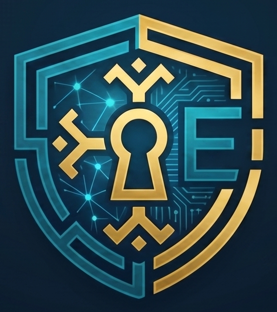
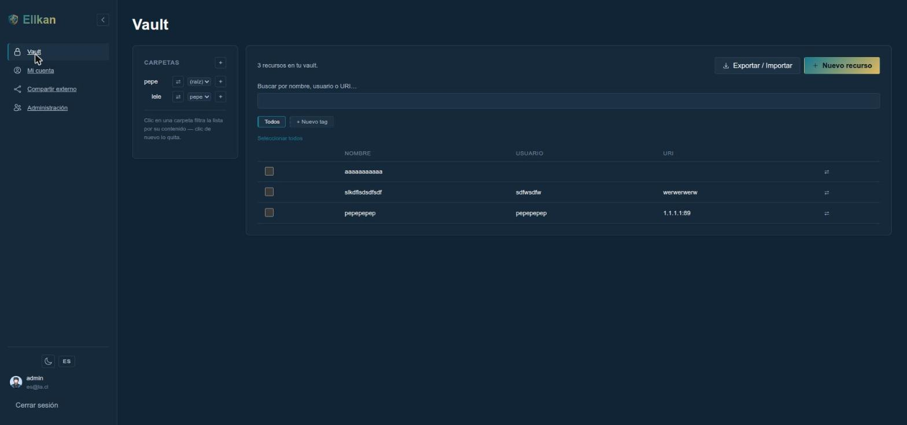
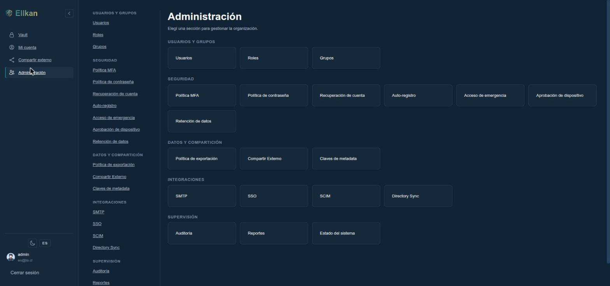
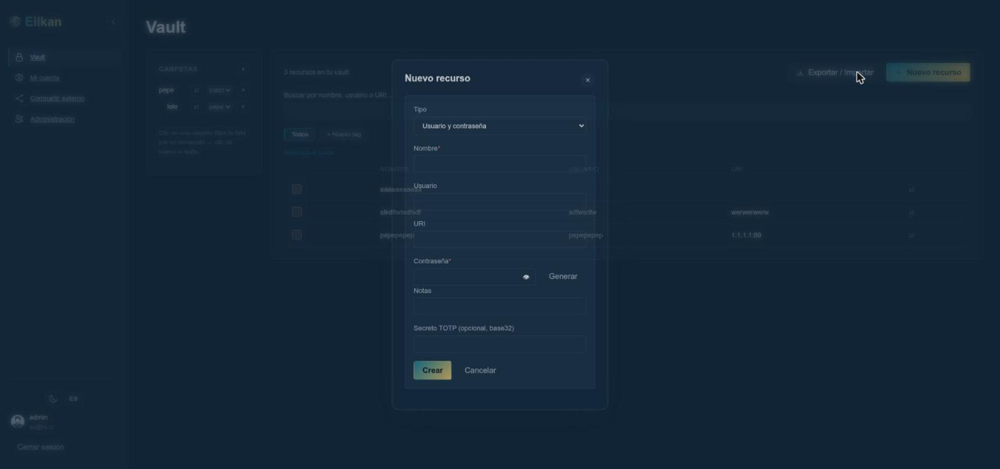
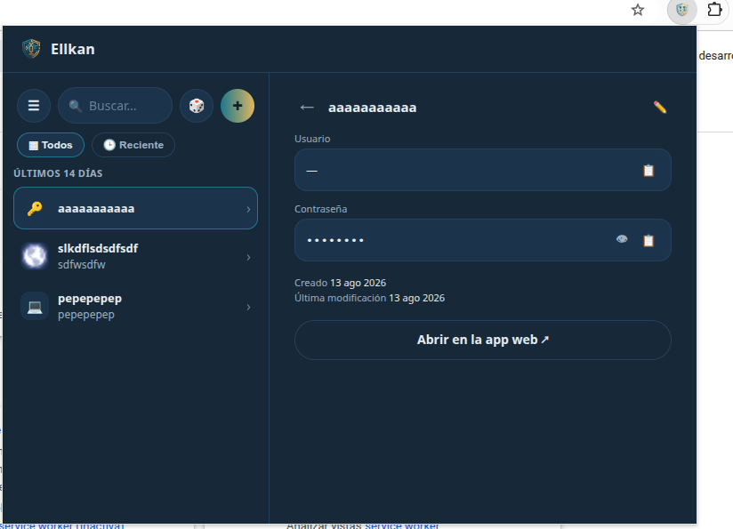
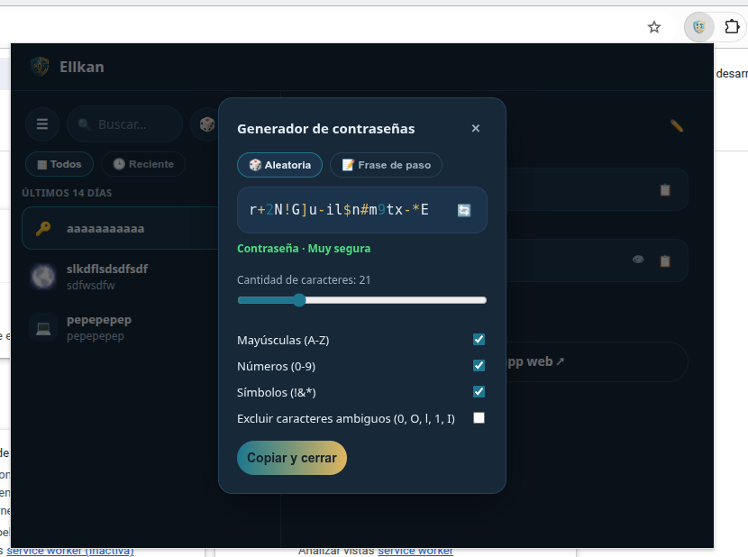
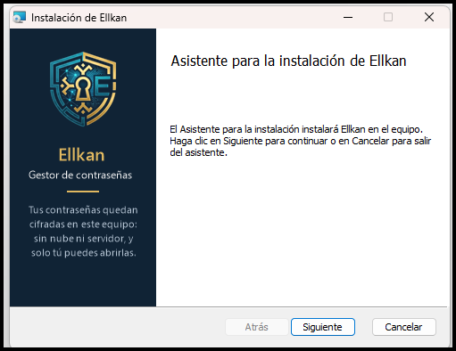
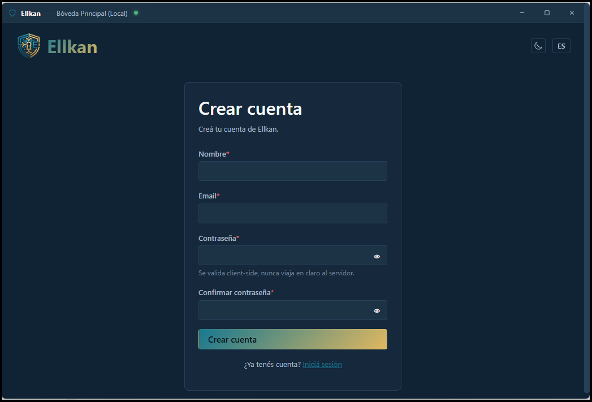
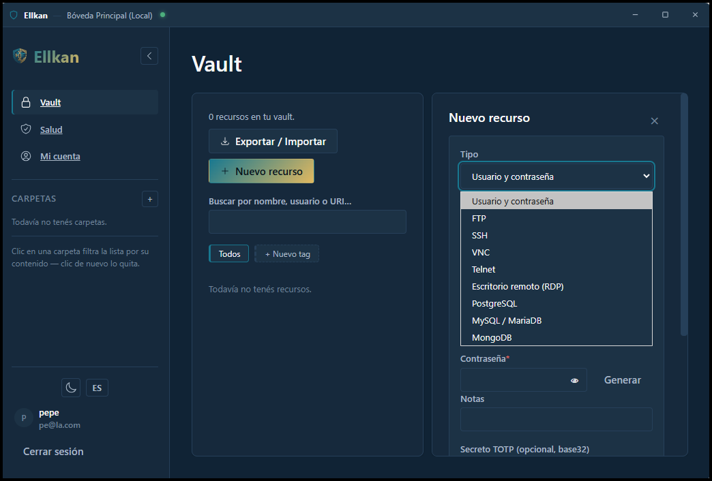
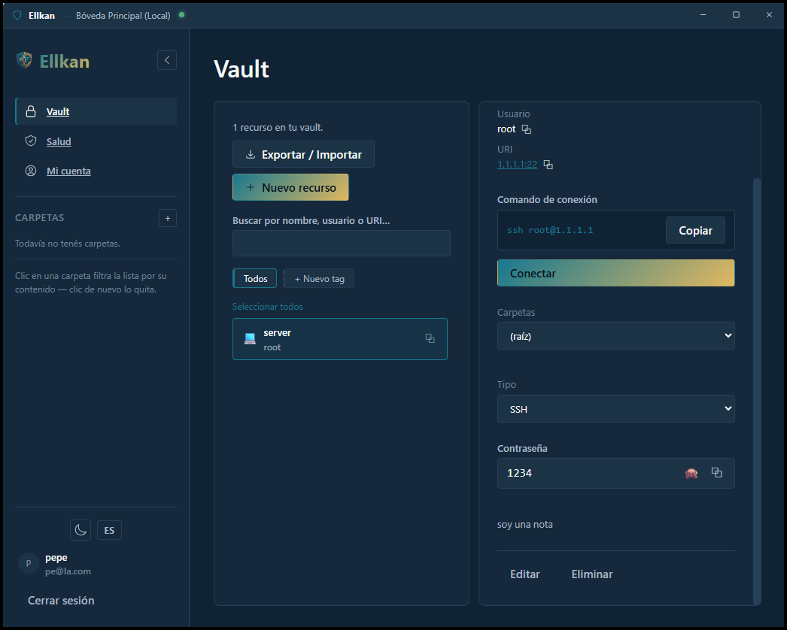

<p align="center">
  
</p>

<h1 align="center">Ellkan</h1>
<p align="center">Gestor de contraseñas zero-knowledge, self-hosted.</p>
<p align="center"><b>Español</b> (este archivo) · <a href="README.en.md">English</a></p>

<p align="center">
  <a href="https://www.buymeacoffee.com/athomo"></a>
</p>

**Ellkan** — del mapudungún *elkan*, "esconder, ocultar".

> [!WARNING]
> **Desarrollo en fase beta.** La interfaz, el esquema de datos y la API pueden cambiar entre versiones sin migración automática. Todavía no lo uses como tu único gestor de contraseñas productivo para tu empresa.

## Qué es Ellkan

Un gestor de contraseñas self-hosted con arquitectura zero-knowledge: el servidor nunca ve tus claves privadas ni tus secretos en claro. Backend en Rust (Axum), cifrado con primitivas modernas (X25519, Ed25519, XChaCha20-Poly1305, Argon2id), frontend web y extensión de navegador comparten el mismo núcleo criptográfico compilado a WebAssembly.

## Aplicaciones

| Aplicación | Para qué sirve | Más información |
| --- | --- | --- |
| **Web + servidor** | El servidor Ellkan para un equipo: usuarios, grupos, compartir y administración. Es lo que levanta la [instalación rápida](#instalación-rápida). | [Manual de instalación](manual/instalacion.md) |
| **Escritorio (Windows)** | Gestor de contraseñas para **una sola persona**. Todo queda cifrado en tu PC: funciona sin conexión, sin servidor y sin cuenta en la nube, y opcionalmente se conecta a un servidor Ellkan. Trae instalador MSI, bandeja del sistema con atajo global, botón «Conectar» (SSH, RDP, PostgreSQL, MySQL, MongoDB, FTP, Telnet, VNC), salud de la bóveda, copias de seguridad automáticas y la extensión de navegador incluida. | [Guía de la app de escritorio](app-escritorio/GUIA.md) |
| **Extensión de navegador** | Autocompleta tus credenciales en Chrome, Edge, Brave, Opera y Firefox. Funciona con el servidor o con la app de escritorio, desde la que también se instala. | [Extensión de navegador](extension/README.md) |

## Capturas

| Vault | Panel de administración | Nuevo recurso |
| --- | --- | --- |
|  |  |  |

| Extensión — detalle de un recurso | Extensión — generador de contraseñas |
| --- | --- |
|  |  |

### App de escritorio (Windows)

| Instalador MSI | Primer uso: crear la cuenta |
| --- | --- |
|  |  |

| Nuevo recurso: SSH, RDP, bases de datos… | «Conectar» abre el cliente ya listo |
| --- | --- |
|  |  |

## Stack técnico

### Backend

| Componente | Tecnología |
| --- | --- |
| Lenguaje | Rust (edición 2024) |
| Framework web | Axum (sobre Tokio) |
| Base de datos | PostgreSQL 18+ |
| Acceso a datos | `sqlx`, queries verificadas en tiempo de compilación |
| Autenticación | Firma de nonce con Ed25519 — sin passwords en el servidor |
| Arquitectura | Monolito modular (Controller → Service → Repository) |
| Despliegue | Docker / Docker Compose |

### Frontend y extensión

| Componente | Tecnología |
| --- | --- |
| Frontend web | SvelteKit + TypeScript |
| Extensión de navegador | Manifest V3 (Chrome, Firefox, Safari) |
| Núcleo criptográfico | Compilado a WebAssembly, compartido entre backend, web y extensión |
| Gestor de paquetes | pnpm |
| Testing E2E | Playwright |

### Criptografía

| Primitiva | Uso |
| --- | --- |
| X25519 | Acuerdo de claves (cifrado de extremo a extremo) |
| Ed25519 | Firmas digitales (autenticación) |
| XChaCha20-Poly1305 | Cifrado autenticado (AEAD) de secretos y metadata |
| Argon2id | Derivación de clave maestra desde la passphrase |
| HKDF-SHA256 | Derivación de subclaves con dominio separado por contexto |
| zeroize / secrecy | Borrado y redacción seguros de secretos en memoria |
| subtle | Comparaciones en tiempo constante (mitiga timing attacks) |

## Instalación rápida

Requiere Docker y Docker Compose.

```bash
git clone https://github.com/athomo001/Ellkan.git
cd Ellkan
cp .env.example .env
set -a && source .env && set +a

# Secretos de despliegue — ver secrets/README.md para el detalle de cada uno.
# Usa POSTGRES_USER/POSTGRES_DB del .env recién cargado — si los cambiaste
# ahí arriba, esto arma el DATABASE_URL correcto solo, sin que haya que
# tocarlo a mano en dos lugares.
openssl rand -hex 24 > secrets/postgres_password.txt
openssl rand -base64 32 > secrets/ellkan_secrets_key.txt
echo "postgres://${POSTGRES_USER:-ellkan}:$(cat secrets/postgres_password.txt)@ellkan-db:5432/${POSTGRES_DB:-ellkan}" > secrets/database_url.txt

docker compose up -d
```

> **Esto es sólo para la primera vez.** Para cualquier cambio posterior (`git pull`, o código propio) `docker compose up -d` solo **no alcanza** — sigue usando la imagen vieja. Hace falta `docker compose build ellkan` antes — ver [Actualizar / reconstruir tras un cambio](#actualizar--reconstruir-tras-un-cambio) más abajo.

La app queda en `http://localhost:${ELLKAN_PORT:-8080}`. El primer admin se crea vía CLI (todavía no hay binarios pre-compilados — se compila desde el código):

```bash
cargo build --release -p ellkan-cli

# DATABASE_URL acá es DISTINTO al de secrets/database_url.txt: ese usa el
# hostname interno de Docker (ellkan-db), que sólo resuelve dentro de la
# red de contenedores — este apunta al puerto que docker-compose expone
# en 127.0.0.1 para que la CLI (corriendo en el host) pueda conectarse.
DATABASE_URL="postgres://${POSTGRES_USER:-ellkan}:$(cat secrets/postgres_password.txt)@localhost:${POSTGRES_PORT:-5433}/${POSTGRES_DB:-ellkan}" \
  ./target/release/ellkan-cli admin create-user \
  --email vos@ejemplo.com --display-name "Tu nombre" --role admin

./target/release/ellkan-cli --server-url "http://localhost:${ELLKAN_PORT:-8080}" login --email vos@ejemplo.com
```

`--role admin` promueve directo (por SQL, sin pasar por HTTP — ninguna ruta HTTP permite auto-asignarse admin) y marca este dispositivo como conocido, así que el `login` de arriba funciona ahí mismo sin esperar ningún email — no hace falta SMTP configurado para arrancar. Una vez adentro, para que las verificaciones de dispositivo de cualquier otro login/usuario lleguen por email de verdad, configurá un relay real en `/admin/smtp`.

Ver [manual/cli.md](manual/cli.md#comandos) para el resto de los comandos.

### Windows (PowerShell)

Los comandos de arriba son para Linux/macOS (`bash`). En Windows, desde cero:

**1. Instalar lo necesario** (una sola vez, en PowerShell; reiniciá la sesión al terminar):

```powershell
winget install --id Git.Git -e
winget install --id Docker.DockerDesktop -e
winget install --id Rustlang.Rustup -e   # sólo para compilar la CLI (paso 5)
```

Abrí Docker Desktop y esperá a que diga que el motor está corriendo. Rust en Windows necesita las *Build Tools de Visual Studio* (C++): si faltan, `cargo build` lo avisa; se instalan con `winget install --id Microsoft.VisualStudio.2022.BuildTools -e --override "--add Microsoft.VisualStudio.Workload.VCTools --includeRecommended --passive"`.

**2. Clonar y cargar el `.env`:**

```powershell
git clone https://github.com/athomo001/Ellkan.git
cd Ellkan
Copy-Item .env.example .env

# Equivalente a `set -a && source .env`: sólo dura en esta ventana.
Get-Content .env | Where-Object { $_ -match '^\s*[^#\s][^=]*=' } | ForEach-Object {
    $k, $v = $_ -split '=', 2
    Set-Item "env:$($k.Trim())" $v.Trim()
}
```

**3. Generar los secretos** (sólo la primera vez — si ya levantaste el servidor, no los regeneres: la base guarda la contraseña en su volumen y la clave de secretos protege datos ya cifrados):

```powershell
function Aleatorio([int]$n) {
    $b = New-Object byte[] $n
    [Security.Cryptography.RandomNumberGenerator]::Create().GetBytes($b)
    return ,$b
}

# Equivalente a `openssl rand -hex 24` y `openssl rand -base64 32`.
$pass = -join ((Aleatorio 24) | ForEach-Object { $_.ToString('x2') })
Set-Content secrets/postgres_password.txt $pass -NoNewline -Encoding ascii
Set-Content secrets/ellkan_secrets_key.txt ([Convert]::ToBase64String((Aleatorio 32))) -NoNewline -Encoding ascii
Set-Content secrets/database_url.txt "postgres://$($env:POSTGRES_USER):$pass@ellkan-db:5432/$($env:POSTGRES_DB)" -NoNewline -Encoding ascii
```

`-NoNewline -Encoding ascii` importa: con `>` o `echo`, PowerShell escribe UTF-16 o agrega un `\r\n`, y ese `\r` queda pegado a la contraseña dentro del contenedor Linux.

**4. Levantar:**

```powershell
docker compose up -d
```

La app queda en `http://localhost:8080` (el primer build tarda varios minutos).

> Si falla con `bind source path does not exist: .../secrets/postgres_password.txt` aunque el archivo existe, Docker Desktop no está viendo el disco: reinicialo (o `wsl --shutdown`) y volvé a levantar. Detalle en [manual/instalacion.md](manual/instalacion.md#problemas-comunes-y-cómo-repararlos).

**5. Crear el primer admin:**

```powershell
cargo build --release -p ellkan-cli

$pass = (Get-Content secrets/postgres_password.txt -Raw).Trim()
$env:DATABASE_URL = "postgres://$($env:POSTGRES_USER):$pass@localhost:$($env:POSTGRES_PORT)/$($env:POSTGRES_DB)"

.\target\release\ellkan-cli.exe admin create-user --email vos@ejemplo.com --display-name "Tu nombre" --role admin
.\target\release\ellkan-cli.exe --server-url "http://localhost:$($env:ELLKAN_PORT)" login --email vos@ejemplo.com
```

Si abrís otra ventana de PowerShell, repetí la carga del `.env` (paso 2, desde `Get-Content .env`) antes del paso 5. Para actualizar tras un cambio, los mismos dos comandos de la sección siguiente funcionan igual en PowerShell.

Por defecto el backend sirve HTTP plano — para TLS (terminado por el propio Ellkan, sin reverse proxy aparte, o con uno), backup/restauración y solución de problemas comunes, ver [manual/instalacion.md](manual/instalacion.md).

### Actualizar / reconstruir tras un cambio

```bash
git pull
docker compose build ellkan
docker compose up -d ellkan
```

Los dos comandos son necesarios: `build` arma la imagen nueva, pero `up -d` es el que efectivamente reemplaza el contenedor corriendo — olvidarse de este segundo paso es el error más común. Si después de esto no ves el cambio, probablemente sea el navegador sirviendo el bundle viejo desde su propia caché (`Ctrl+Shift+R`/`Cmd+Shift+R`, o probar en una ventana privada); si eso tampoco alcanza, ver [Reconstruir sin caché](manual/instalacion.md#reconstruir-sin-caché-cuando-un-cambio-no-aparece) en el manual, con el paso extra para un build sin ninguna capa cacheada.

> **`docker compose build ellkan` puede tardar varios minutos, cada vez** (no sólo la primera) — el build compila el backend en Rust en modo release desde cero (todo el árbol de dependencias, no sólo lo que cambiaste) más el núcleo criptográfico a WebAssembly, sin caché de compilación entre builds. Es esperado, no significa que quedó colgado.

### Requisitos de hardware (estimación, no medida con carga real — detalle y supuestos en [manual/instalacion.md](manual/instalacion.md#requisitos-de-hardware--estimación-razonada-no-medida-con-carga-real))

| | Mínimo | Recomendado |
| --- | --- | --- |
| CPU | 1 vCPU | 2 vCPU |
| RAM | 512 MB | 2 GB |
| Disco | 1 GB + datos | 10 GB + datos |
| Usuarios concurrentes activos | ~10-20 | ~50-100 |

## Documentación

- [manual/funcionalidades.md](manual/funcionalidades.md) — qué hace Ellkan, por área.
- [manual/cli.md](manual/cli.md) — referencia completa de `ellkan-cli`.
- [manual/instalacion.md](manual/instalacion.md) — TLS, backup/restauración, troubleshooting, requisitos de hardware.
- [manual/seguridad.md](manual/seguridad.md) — qué está cifrado y qué no, y qué pasa si alguien intenta sacar los datos (con diagramas).
- [extension/README.md](extension/README.md) — desarrollo, build y empaquetado de la extensión de navegador.

## Preguntas frecuentes

**¿El servidor puede ver mis contraseñas?**
No. Todo se cifra y se descifra en tu dispositivo, nunca en el servidor — es como dejarle a alguien una caja fuerte cerrada para guardar: puede guardarla, pero nunca tiene la llave para abrirla ni ver qué hay adentro.

Lo que el servidor sí ve son datos de la cuenta que necesita para funcionar: tu correo, tu nombre, a qué grupos pertenecés, fechas de creación y modificación, y la IP desde la que te conectás. Hay una excepción elegida a propósito: cuando compartís un secreto con alguien **de afuera** mediante un link externo, quien tenga el link completo puede abrir ese secreto (por eso esos links vencen rápido y pueden llevar una contraseña extra enviada por otro canal).

**¿Qué pasa si alguien roba la base de datos del servidor?**
No consigue tus contraseñas — sólo consigue cajas fuertes cerradas. Sin tu contraseña maestra (que el servidor nunca recibe), no hay forma de abrirlas con lo que hay en la base. Las únicas otras vías son las de recuperación de cuenta, y las activás vos o tu organización: tu propio kit de recuperación (un archivo que sólo vos guardás) o, si tu organización lo configuró, la recuperación aprobada por administradores.

**¿Cómo protegen mis claves en la memoria de la computadora (RAM) mientras las uso?**
Mientras la bóveda está **bloqueada**, en tu equipo no hay ninguna clave en memoria: sólo texto cifrado en disco, y tu contraseña maestra no se guarda en ningún lado (si activás el desbloqueo rápido —con un código TOTP o con Windows Hello— queda **cifrada** en ese dispositivo). Mientras está **desbloqueada**, tus claves privadas sí están en memoria, porque hacen falta para descifrar: un programa malicioso que ya esté en tu sesión, o un volcado de memoria en ese momento, podría leerlas. Al bloquear (a mano, por inactividad o al bloquear Windows) se descartan. Ningún gestor de contraseñas puede protegerte de un equipo ya comprometido; por eso conviene bloquear al alejarte. El detalle, con casos de qué pasa si alguien intenta sacar los datos, está en [manual/seguridad.md](manual/seguridad.md).

## Estado

En desarrollo activo. Backend y frontend web funcionales de punta a punta (registro, login, vault, grupos, MFA, SSO/SCIM/LDAP, auditoría, panel de administración, exportación/backup). La extensión de navegador (Chrome, Edge, Brave, Opera, Firefox) también funciona de punta a punta — login, sesión inteligente, bóveda con autofill, generador de contraseñas — ver [extension/README.md](extension/README.md); Safari queda pendiente (exige empaquetado nativo vía Xcode).

## Seguridad

Ellkan no tuvo todavía una auditoría de seguridad externa propia. Si encontrás una vulnerabilidad, por favor no abras un issue público: seguí los pasos de [SECURITY.md](SECURITY.md).

## Sin garantía

Ellkan se distribuye **tal cual, sin ninguna garantía**, ni siquiera la implícita de comerciabilidad o de aptitud para un propósito particular, y sin responsabilidad por daños que resulten de su uso (secciones 15 y 16 de la AGPL-3.0). Está en beta: hacé copias de seguridad de tu bóveda.

## Licencia

Copyright (C) 2026 Athan Espinoza.

**AGPL-3.0** — ver [LICENSE](LICENSE) (texto oficial en inglés, el único legalmente vinculante) y [LICENSE.es.txt](LICENSE.es.txt) (traducción no oficial al español, sólo de referencia). Si modificás Ellkan y lo ofrecés a otras personas por red, la AGPL te obliga a ofrecerles el código fuente de tu versión: la app muestra un link «Código fuente» que podés apuntar a tu repositorio con `VITE_ELLKAN_SOURCE_URL` al compilar el frontend.

Las dependencias de terceros y sus licencias están en [THIRD-PARTY-NOTICES.md](THIRD-PARTY-NOTICES.md).

### Propiedad intelectual y política de marca

El código fuente de este proyecto se distribuye bajo la licencia AGPL-3.0. Sin embargo, los siguientes elementos quedan expresamente excluidos de dicha licencia:

- El nombre **Ellkan**.
- El diseño, imagotipo y archivos visuales contenidos en [`assets/logo/`](assets/logo/), cuya autoría y derechos de autor pertenecen exclusivamente al autor del proyecto.

Se autoriza el uso del nombre y logo exclusivamente con fines descriptivos o de atribución. Cualquier bifurcación (fork), distribución modificada o servicio derivado no oficial debe eliminar toda la identidad visual original y adoptar una denominación propia.
