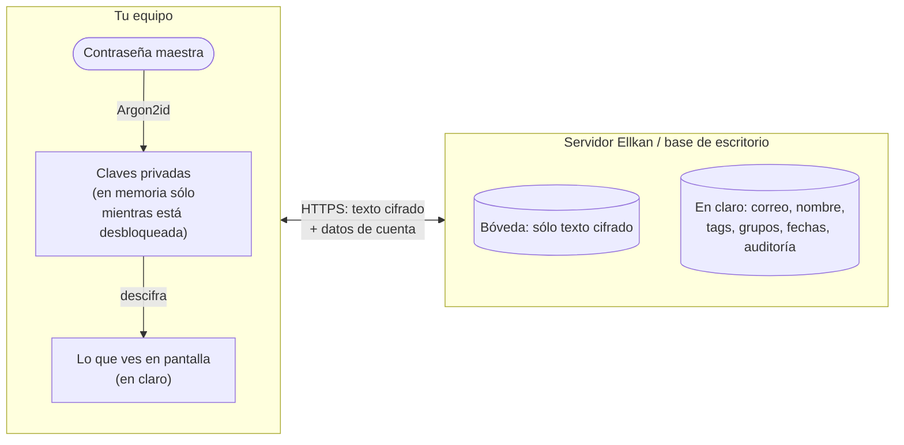
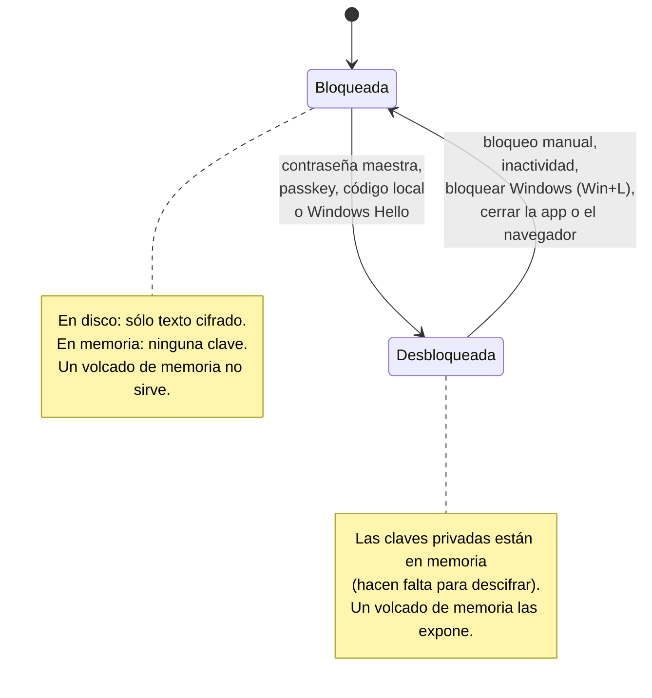
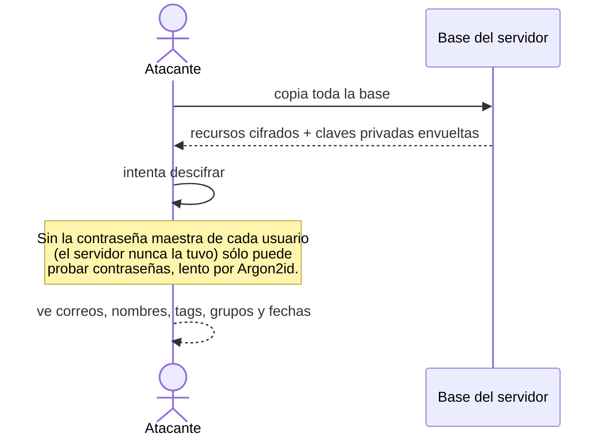
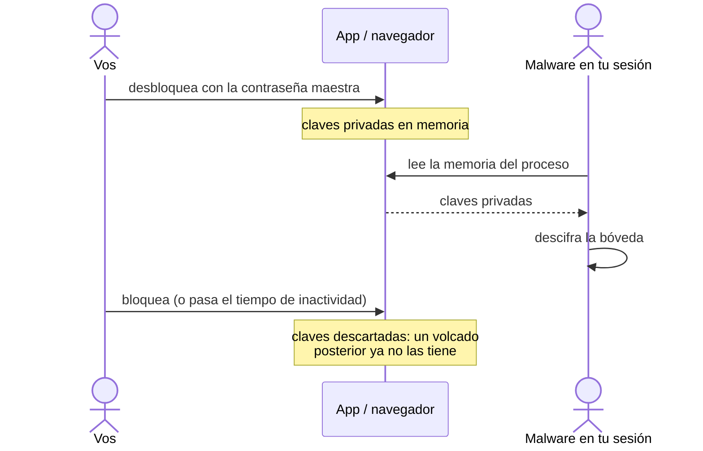
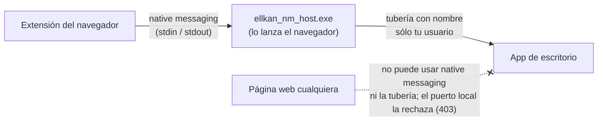

# Seguridad: qué protege Ellkan y qué no

Esta página explica, sin vueltas, dónde están tus datos, cuándo están cifrados y qué pasa si alguien intenta sacarlos. Los diagramas se ven como gráficos en GitHub (Mermaid).

> **Resumen.** El contenido de tu bóveda (contraseñas, notas, usuarios, URLs, nombres de carpetas) se cifra y descifra **sólo en tu dispositivo**. El servidor, la base de datos de la app de escritorio y las copias de seguridad guardan únicamente texto cifrado. La protección más débil es **tu propio equipo mientras la bóveda está desbloqueada**: ahí las claves están en memoria, porque hacen falta para descifrar.

---

## 1. Qué está cifrado y qué no

| Dato | ¿Cifrado? | Dónde | Quién puede leerlo |
| --- | --- | --- | --- |
| Contraseñas, notas, secretos TOTP, tokens | ✅ Sí (de extremo a extremo) | Servidor, base de escritorio, copias | Sólo vos (y con quien compartas) |
| Nombre, usuario y URL de cada recurso | ✅ Sí | Ídem | Ídem |
| Nombres de carpetas | ✅ Sí | Ídem | Ídem |
| Tu clave privada | ✅ Sí, envuelta con tu contraseña maestra (Argon2id) | Servidor y base de escritorio | Nadie sin la contraseña maestra o el kit de recuperación |
| Correo, nombre visible, avatar | ❌ No | Servidor y base de escritorio | El operador del servidor |
| Nombres de tags y de grupos | ❌ No (decisión de diseño: se buscan y filtran en el servidor) | Ídem | Ídem |
| Fechas, membresías, quién compartió qué con quién | ❌ No | Servidor | Ídem |
| Registro de auditoría (quién hizo qué y cuándo, nunca el contenido) | ❌ No | Servidor | Administradores y auditores |
| Correos que manda el servidor (destinatario y cuerpo) | ❌ No; se borran a los 7 días de enviados | Servidor | El operador |
| Tu IP | No se guarda en disco: sólo en memoria, unos segundos, para limitar intentos | — | — |

---

## 2. Bloqueada vs. desbloqueada

La diferencia entre "imposible" y "posible" para un atacante en tu equipo es si la bóveda está **desbloqueada**.

**Mientras está desbloqueada**, en memoria están:
- tus claves privadas (en la web y la app, en la memoria de la ventana; en la extensión, en su almacenamiento de sesión, que también vive en memoria);
- las contraseñas que revelaste o copiaste;
- en el modo "sólo memoria" de la app conectada, las contraseñas que se pidieron al servidor.

Al bloquear se descartan. Como la web y la extensión corren en JavaScript, el navegador decide cuándo reutiliza esa memoria, así que pueden quedar restos un tiempo. Por eso conviene **bloquear al alejarte** y dejar activos el bloqueo por inactividad y el bloqueo con Windows.

---

## 3. Casos: qué pasa si alguien intenta sacar los datos

| # | Quién / cómo | ¿Obtiene contraseñas? | Por qué |
| --- | --- | --- | --- |
| 1 | Roba la **base de datos del servidor** o una copia de seguridad | ❌ No | Sólo hay texto cifrado y claves privadas envueltas con contraseñas que el servidor nunca recibe. Ve correos, nombres, tags, grupos y fechas. |
| 2 | El **administrador del servidor**, curioso | ❌ No | Mismo caso que el 1: administra cuentas y políticas, pero no tiene tus claves. *Excepción:* si la organización activó la recuperación de cuenta con custodia, varios administradores juntos pueden restablecer tu acceso. |
| 3 | Escucha la **red** (Wi-Fi pública, proxy) | ❌ No | Entre tu equipo y el servidor viaja texto cifrado, y además va por HTTPS si el servidor lo tiene configurado. El login es una firma: tu contraseña nunca viaja. |
| 4 | Roba tu **notebook apagada o con la bóveda bloqueada** | ❌ No, salvo que adivine tu contraseña maestra | La base local tiene sólo texto cifrado. Argon2id hace lento probar contraseñas, pero una contraseña maestra débil se puede adivinar sin conexión: usá una frase larga. |
| 5 | **Malware en tu sesión**, o alguien que hace un **volcado de memoria** con la bóveda **desbloqueada** | ⚠️ Sí | Las claves están en memoria. Ningún gestor de contraseñas protege contra esto: un programa con tu nivel de acceso también puede leer la pantalla y el teclado. |
| 6 | Una **página web** maliciosa intenta hablarle a la app de escritorio | ❌ No | La extensión habla con la app por *native messaging* (sin puerto de red). El puerto local que sigue abierto para la ventana de la app rechaza a cualquier página web (403) y exige una sesión. |
| 7 | **Otro usuario de la misma PC** con Windows | ❌ No | La base está en tu perfil, y el canal entre la extensión y la app es una tubería sólo para tu usuario. Un administrador del equipo sí puede leer tu memoria (caso 5). |
| 8 | Consigue un **link de "compartir externo"** | ⚠️ Sí, ese secreto | Es la excepción deliberada: la clave va en el link. Por eso vencen, se agotan y pueden pedir una contraseña adicional enviada por otro canal. |
| 9 | Consigue tu **kit de recuperación** y tu correo | ⚠️ Sí | El kit es otra forma de entrar: guardalo separado de la computadora. |
| 10 | Te **bloquean o borran la cuenta** en el servidor | — | La app de escritorio conectada borra la bóveda local apenas se entera (sólo ante un aviso firmado por ese servidor) y la extensión cierra sesión. Un equipo que nunca vuelve a conectarse conserva sus datos. |

### Caso 1: roban la base del servidor

### Caso 5: malware con la bóveda desbloqueada

### Caso 6: la extensión y la app de escritorio

Sólo la extensión oficial de Ellkan (su ID está registrado) puede abrir ese canal, y la app sólo atiende al `ellkan_nm_host.exe` de su propia carpeta. No pasa nada por la red, ni siquiera por `127.0.0.1`. Si la app no está abierta, o con una versión anterior, la extensión usa el servidor que tenga configurado.

---

## 4. Lo que Ellkan no puede evitar

- **Un equipo comprometido** (malware, alguien con permisos de administrador mientras usás la bóveda): ve lo mismo que vos.
- **Lo que ya viste o copiaste**: si alguien tuvo acceso a una contraseña, cambiarla es la única solución. Bloquear o borrar una cuenta reduce la exposición, pero no reemplaza cambiar las contraseñas a las que esa persona tenía acceso.
- **Una contraseña maestra débil**: protege todo lo demás. Usá una frase larga y única.
- **Una app modificada**: Ellkan es software libre; una versión alterada puede ignorar cualquier protección. Instalá desde la fuente oficial.

## 5. Recomendaciones

1. Una contraseña maestra larga (una frase de 5 o más palabras) que no uses en otro lado.
2. Guardá el kit de recuperación fuera de la computadora.
3. Dejá activos el bloqueo por inactividad y el bloqueo al bloquear Windows; bloqueá al alejarte.
4. En el servidor, configurá HTTPS (ver [instalacion.md](instalacion.md)) y mantené Ellkan actualizado.
5. Si una persona deja la organización, además de bloquear su cuenta, cambiá las contraseñas compartidas a las que tenía acceso.

Ellkan todavía no tuvo una auditoría de seguridad externa. Para reportar una vulnerabilidad, ver [SECURITY.md](../SECURITY.md).
